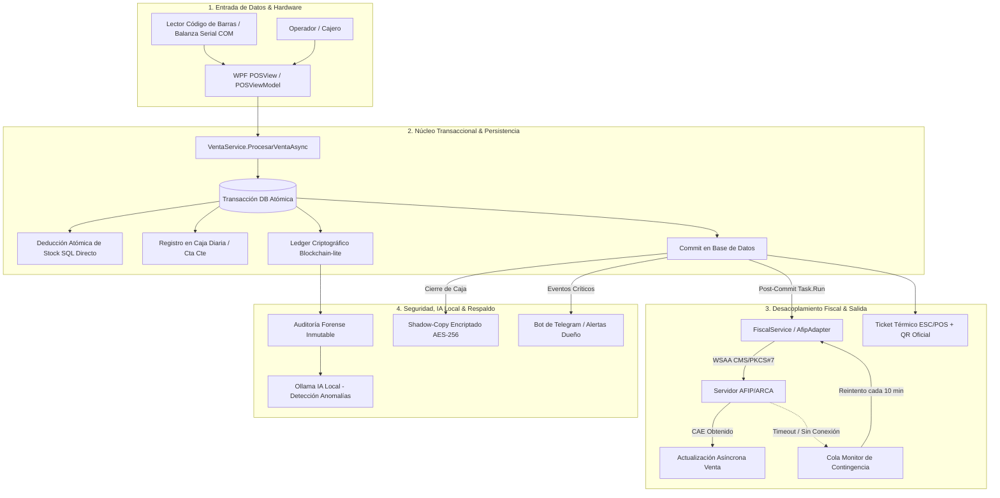

# Bastión POS Seguro (Gold Master) - Documentación Técnica de Arquitectura

> **Documento de Ingeniería de Software para Portfolio, CV y Auditoría Técnica**  
> **Perfil:** Arquitectura de Software Enterprise / Senior .NET & Ciberseguridad  
> **Estándares y Regulaciones:** ISO 27001 (Seguridad de la Información), RG AFIP/ARCA (Facturación Electrónica), ACID, MVVM Pattern, HACCP (Trazabilidad de Alimentos).  
> **Confidencialidad:** Este documento describe la arquitectura de alto nivel, patrones de diseño, flujos transaccionales y estrategias de resiliencia del sistema **sin exponer código fuente propietario, credenciales ni claves criptográficas privadas**.

---

## 📝 Descripción General

**Bastión POS Seguro** es un ecosistema integral de Punto de Venta (POS) y ERP comercial de grado empresarial, diseñado específicamente para operar en entornos retail de misión crítica donde la tolerancia al fallo es cero (supermercados, mayoristas, distribuidores y comercios minoristas de alto volumen).

### Problemática que Resuelve
1. **Pérdida de Ventas por Caídas de Conectividad o Indisponibilidad Estatal:** Los sistemas tradicionales de facturación electrónica se congelan cuando los servidores de la entidad tributaria (ARCA/AFIP) o el proveedor de internet sufren microcortes o latencias elevadas, provocando colas de espera y detención del comercio.
2. **Vulnerabilidad y Extracción Física de Datos:** En instalaciones locales, el robo de computadoras o discos rígidos expone bases de datos completas de clientes, precios y balances financieros en texto plano.
3. **Fraude Interno y Manipulación de Registros:** Discrepancias de caja ocultadas en cierres de turno, adulteración de comprobantes o borrado directo de registros en la base de datos por parte de administradores o personal con acceso.
4. **Degradación de Rendimiento en Grandes Volúmenes:** Colapso de la interfaz gráfica y saturación de memoria RAM al gestionar decenas de miles de productos, ventas concurrentes y lecturas de periféricos en tiempo real.

### Propuesta de Valor Arquitectónica
Bastión POS Seguro resuelve estos desafíos mediante:
* **Persistencia Híbrida Dual:** Operación 100% autónoma offline en terminales individuales con SQLite cifrado mediante SQLCipher y hardware-binding (HWID), combinada con capacidades de red empresarial distribuida sobre PostgreSQL 16.
* **Desacoplamiento Fiscal Asíncrono Post-Commit:** Las transacciones comerciales se aseguran localmente en menos de 20 milisegundos, liberando la caja de inmediato, mientras la fiscalización electrónica y emisión de CAE se gestiona en segundo plano con un monitor de contingencia persistente.
* **Libro Mayor Inmutable (Blockchain-Lite):** Cadena criptográfica de bloques SHA-256 para auditoría forense donde cada evento vincula el hash del registro anterior, impidiendo cualquier modificación o eliminación retroactiva de datos.
* **Arqueo Ciego y Respaldo Invisible (Shadow-Copy):** Control de fondos sin exposición de saldos teóricos y generación automática de copias de seguridad cifradas en segundo plano ante cierres de turno.

---

## 🛠️ Stack Tecnológico

```
┌────────────────────────────────────────────────────────────────────────────┐
│                       ARQUITECTURA DE CAPAS Y TECNOLOGÍAS                  │
├────────────────────────────────────────────────────────────────────────────┤
│ CAPA DE PRESENTACIÓN (UI / UX):                                            │
│ • C# 12 / .NET 8 LTS | WPF (Windows Presentation Foundation)               │
│ • Renderizado Vectorial DirectX | VirtualizingStackPanel (Virtualización)  │
│ • Patrón MVVM Puro | CommunityToolkit.Mvvm | LiveChartsCore (SkiaSharp)    │
├────────────────────────────────────────────────────────────────────────────┤
│ CAPA DE APLICACIÓN Y LÓGICA DE NEGOCIO:                                    │
│ • Inyección de Dependencias (ServiceCollection / ServiceProvider)          │
│ • Bus de Mensajería Desacoplado (Prism EventAggregator)                    │
│ • Concurrencia Asíncrona (Task Parallel Library, SemaphoreSlim)            │
│ • P/Invoke Win32 API (Spooler de Impresión Raw ESC/POS, Puertos COM)       │
├────────────────────────────────────────────────────────────────────────────┤
│ CAPA DE PERSISTENCIA (ARQUITECTURA DUAL-ENGINE):                           │
│ • Standalone / Offline: SQLite 3 + SQLCipher (Cifrado Físico AES-256 HWID) │
│ • Sincronización Dinámica DDL en Frío: SchemaEnsurerService                │
│ • Red Multi-Caja / Servidor: PostgreSQL 16 (Transacciones ACID, Concurrencia)│
│ • Sincronización en Tiempo Real: PostgreSQL LISTEN / NOTIFY                │
│ • Integridad Decimal: decimal(18,2) para moneda y decimal(18,3) para pesos │
├────────────────────────────────────────────────────────────────────────────┤
│ CAPA FISCAL, PERIFÉRICOS Y COMUNICACIONES:                                 │
│ • Fiscalización ARCA/AFIP: Webservices WSAA (CMS/PKCS#7) + WSFEv1          │
│ • Periféricos: Balanzas Seriales RS-232/COM (Systel, Kretz)                │
│ • Impresión Térmica: ESC/POS Nativo (Corte de papel, cajón, QR Oficial)   │
│ • API REST Local: HttpListener en proceso (Puerto 8765) con API-Key        │
│ • Alertas Remotas: Telegram Bot API (Notificaciones HTTPS asíncronas)      │
├────────────────────────────────────────────────────────────────────────────┤
│ CAPA DE SEGURIDAD, LICENCIAMIENTO E IA LOCAL:                              │
│ • Auditoría Forense: Ledger Criptográfico Encadenado SHA-256 (ISO 27001)   │
│ • Licenciamiento: Tokens JWT firmados RSA-2048 SHA-256 + 2FA OTP vía Email│
│ • Anti-Tampering: SafeTimeService con marcas de agua ocultas en disco      │
│ • IA Local / Edge AI: Ollama (Llama 3 8B / Mistral 7B) en entorno aislado │
│ • Suite de Testing y QA: Python 3.10 + PyWinAuto (AITester.py)             │
└────────────────────────────────────────────────────────────────────────────┘
```

### Detalle de Especificaciones Técnicas

* **Sistemas Operativos Soportados:**
  * *Terminales Cliente / Cajas POS:* Windows 10 / Windows 11 Pro (64-bit).
  * *Servidores de Red / Clúster de Datos:* Linux Debian 12 / Ubuntu Server 22.04 LTS (o Windows Server) para el motor PostgreSQL.
* **Entorno de Ejecución:** .NET 8.0 Runtime (Compilación con optimización de código intermedio CIL, soporte AOT en módulos criptográficos).
* **Integridad Numérica Estricta:** Implementación absoluta del tipo de dato `decimal` en C# mapeado a tipos nativos SQL (`numeric(18,2)` para dinero y `numeric(18,3)` para pesaje), anulando los desvíos financieros por redondeo IEEE 754 de punto flotante.
* **Componentes de Inteligencia Artificial y Automatización:**
  * **Inferencia Local Air-Gapped (Ollama):** Procesamiento de lenguaje natural mediante modelos Llama 3 / Mistral corriendo de forma 100% local en la terminal o servidor. Se encarga de la clasificación predictiva de errores en bitácoras, detección heurística de anomalías de caja y análisis de patrones de compra sin emitir telemetría al exterior.
  * **Testing Automatizado UI/QA (`AITester.py`):** Scripting avanzado en Python utilizando `pywinauto` y `pyautogui` para someter la interfaz gráfica a pruebas de estrés, validación de coordenadas de control, detección de colisiones de color y simulación estocástica de clientes.

---

## 🔄 Flujo de Datos y Arquitectura Transaccional

### Diagrama de Flujo Arquitectónico Integral

```text
 ┌─────────────────────────────────────────────────────────────────────────────────────────┐
 │                                   1. CAPTURA Y ENTRADA                                  │
 └─────────────────────────────────────────────────────────────────────────────────────────┘
        │                                 │                                 │
 [Balanza Serial RS-232]        [Lector Código Barras]             [Pantalla Táctil POS]
  (Lectura continua peso)       (EAN-13: SKU + Peso/Precio)        (Búsqueda insensible)
        │                                 │                                 │
        ▼                                 ▼                                 ▼
 ┌─────────────────────────────────────────────────────────────────────────────────────────┐
 │                         2. INTERFAZ GRÁFICA Y CARRO DE COMPRAS                          │
 │  • POSViewModel evalúa en memoria: combos, promociones, reglas mayoristas multidominio │
 │  • Selección de venta fraccionada (metros, litros, gramos) y métodos de pago mixtos     │
 └─────────────────────────────────────────────────────────────────────────────────────────┘
                                          │
                                 [Presionar Cobrar]
                                          │
                                          ▼
 ┌─────────────────────────────────────────────────────────────────────────────────────────┐
 │                          3. MOTOR TRANSACCIONAL ATÓMICO (ACID)                          │
 │                       VentaService.ProcesarVentaAsync (C# / EF Core)                    │
 ├─────────────────────────────────────────────────────────────────────────────────────────┤
 │  [BEGIN TRANSACTION EXCLUSIVA]                                                          │
 │   1. Validación estricta de saldo y límite en Cuenta Corriente ("Fiado").              │
 │   2. Deducción de stock directa en SQL: UPDATE "Productos" SET "StockActual" = ...      │
 │      (Previene condiciones de carrera y actualiza existencias de productos padre).      │
 │   3. Registro contable de ingreso en Caja Diaria activa (o abono a Cta Cte).           │
 │   4. Acumulación de puntos del programa de fidelización del cliente.                    │
 │   5. Firma digital anti-tampering y acuñación de bloque en AuditoriaService (SHA-256).  │
 │  [COMMIT TRANSACTION - TIEMPO TOTAL < 20 MILISEGUNDOS]                                  │
 └─────────────────────────────────────────────────────────────────────────────────────────┘
                                          │
                   ┌──────────────────────┴──────────────────────┐
                   │ Transacción DB Confirmada y Bloqueos Libres │
                   ▼                                             ▼
 ┌───────────────────────────────────┐         ┌───────────────────────────────────┐
 │    4. DESPACHO FISCAL ASÍNCRONO   │         │    5. EXPERIENCIA Y SALIDA FÍSICA │
 │       (Task.Run Desacoplado)      │         │                                   │
 ├───────────────────────────────────┤         ├───────────────────────────────────┤
 │ • Solicita/Reutiliza TRA en WSAA  │         │ • Generación de Ticket Térmico    │
 │   (Firma CMS/PKCS#7 con .crt/.key)│         │ • Comandos nativos ESC/POS:       │
 │ • Consume WSFEv1 (Facturas A,B,C) │         │   - Impulso de apertura de cajón  │
 │ • Obtiene CAE y Vencimiento       │         │   - Impresión código QR oficial   │
 └───────────────────────────────────┘         │   - Corte total de papel          │
         │                   │                 └───────────────────────────────────┘
   [Éxito AFIP]        [Corte Internet/Timeout]
         │                   │
         ▼                   ▼
 ┌───────────────┐   ┌───────────────────────────┐
 │ Actualización │   │   COLA DE CONTINGENCIA    │
 │ asíncrona de  │   │  • Venta se guarda CAE=null│
 │ CAE en la base│   │  • Timer cada 10 min      │
 │ de datos.     │   │  • PostgreSQL LISTEN/NOTIFY│
 └───────────────┘   │  • Reintento silencioso   │
                     └───────────────────────────┘
```

### Diagrama Mermaid de Arquitectura (Para visores compatibles)



### Explicación Paso a Paso del Flujo de Datos

1. **Captura Física y Homologación de Datos:**
   * La terminal lee en streaming el peso de balanzas comerciales conectadas por puerto COM RS-232 mediante `BalanzaService`.
   * `LabelParserService` interpreta etiquetas EAN-13 generadas por balanzas de mostrador, extrayendo dinámicamente el prefijo de configuración, el identificador único del artículo y el peso o monto cobrado.
   * La búsqueda de productos en memoria ejecuta normalización fonética y de mayúsculas/minúsculas sin bloqueos de interfaz.

2. **Cálculo de Precios y Lógica de Negocio:**
   * `POSViewModel` ejecuta el motor de reglas mayoristas evaluando condiciones de activación por volumen o importe sobre cuatro ámbitos: producto específico, marca, categoría o compra global.
   * Admite venta fraccionada convirtiendo magnitudes estándar (litro, metro, kilogramo) a submúltiplos comerciales (ml, cm, gramo) y descontando del producto matriz.

3. **Garantía Transaccional ACID en Base de Datos:**
   * La operación de venta se ejecuta dentro de un contexto aislado. El descuento de existencias se realiza mediante comandos directos de actualización SQL en lugar de depender del seguimiento en memoria del ORM, garantizando que dos terminales cobrando el mismo producto en el mismo milisegundo mantengan la consistencia exacta de inventario.
   * Se registra la firma criptográfica del comprobante y se confirma (`Commit`) la transacción.

4. **Desacoplamiento Fiscal (ARCA/AFIP) y Resiliencia Post-Commit:**
   * Inmediatamente posterior al `Commit`, el hilo principal despacha el comprobante al cliente y delega la facturación electrónica a una tarea en segundo plano (`Task.Run`).
   * `AfipAdapter` firma criptográficamente el requerimiento mediante el estándar PKCS#7 / CMS con la clave privada del contribuyente y obtiene el Ticket de Acceso (TRA) en WSAA, consumiendo luego WSFEv1.
   * Si el servicio tributario se encuentra caído o la latencia supera el umbral configurado, la venta queda almacenada con estado pendiente (`CAE = null`). El monitor de contingencia en segundo plano (`_afipMonitorTimer`) procesa periódicamente lotes pendientes con técnica de bloqueo de filas no contencioso (`SKIP LOCKED`).

5. **Cierre de Turno y Protección de Fondos:**
   * El cajero realiza un arqueo ciego ingresando el conteo de billetes y monedas sin acceso al monto esperado por el sistema.
   * `CajaViewModel` calcula las desviaciones financieras, asienta el cierre en el registro de auditoría, genera un documento de balance en PDF con QuestPDF y dispara una copia invisible encriptada (**Shadow-Copy**) hacia `%LocalAppData%\BastionPOS\.shadow`.
   * Un bot de Telegram notifica en tiempo real al dueño del negocio con las métricas del turno cerrado.

---

## 🏛️ Catálogo Arquitectónico de Subsistemas (21 Módulos)

El sistema está compuesto por 21 módulos altamente cohesivos y desacoplados:

| N° | Módulo / Subsistema | Responsabilidad Técnica Principal | Patrones / Tecnologías Clave |
| :---: | :--- | :--- | :--- |
| **01** | **Bootstrap & DI Lifecycle** | Arranque seguro, precarga nativa SQLCipher, resolución de dependencias y control de excepciones globales de UI. | `ServiceCollection`, `OnStartup`, `DispatcherUnhandledException` |
| **02** | **Aprovisionamiento Dual** | Creación, blindaje y migración condicional del esquema en SQLite (DDL frío) y PostgreSQL (EF Migrations). | `DatabaseProvisioningService`, `SchemaEnsurerService` |
| **03** | **Shell Principal (MainWindow)** | Hospedaje visual dinámico, virtualización de grillas y escalabilidad proporcional ante cualquier resolución. | `Viewbox`, `CachedViewConverter`, Inactividad ISO 27001 |
| **04** | **Autenticación & RBAC** | Control de acceso basado en roles con claves hash PBKDF2 + sal y contraseñas protegidas en RAM. | `SecureString`, `AuthService`, `SessionData` |
| **05** | **Punto de Venta (POS)** | Carro de compras transaccional, escaneo de balanzas, promociones, reglas mayoristas y cobro multi-método. | MVVM, `BalanzaService`, `LabelParserService` |
| **06** | **Motor de Ventas & ACID** | Descuento atómico de stock, firma de comprobantes, liquidación contable y desacoplamiento fiscal post-commit. | `VentaService`, Transacciones ACID, SQL Directo |
| **07** | **Adaptadores Fiscales** | Autenticación criptográfica CMS/PKCS#7 ante WSAA, facturación WSFEv1 y soporte de impresoras fiscales. | `AfipAdapter`, `FiscalPrinterAdapter`, QR Oficial |
| **08** | **Caja Diaria & Arqueo Ciego** | Control de turnos, apertura con fondo de cambio, arqueo a ciegas, Shadow-Copy y alertas a Telegram. | `CajaViewModel`, `BackupService`, `NotificationBot` |
| **09** | **Inventario & HACCP** | Catálogo, mermas, trazabilidad por lote de vencimiento, fraccionamiento y conteo físico de stock. | `InventarioService`, `MermaService`, `Lote` |
| **10** | **Compras & Abastecimiento** | Recepción de mercadería, actualización de stock, protección del margen de ganancia y cuentas de proveedores. | `ComprasService`, Recálculo dinámico de márgenes |
| **11** | **Clientes & Cuentas Corrientes** | Balance crediticio, fiados, límites de compra y cifrado transparente de PII (DNI, Teléfono, Dirección). | `ClientesService`, ValueConverters AES-256 |
| **12** | **Recursos Humanos & Sueldos** | Nómina de empleados, comisiones por venta, liquidación neta, adelantos y control de vacaciones. | `EmpleadoService`, Liquidación parametrizable |
| **13** | **Gastos Operativos** | Gestión de egresos comerciales fijos y mensuales con impacto automático en caja activa si es efectivo. | `GastosService`, Vinculación contable de caja |
| **14** | **Motor de Reglas Mayoristas** | Descuentos por volumen parametrizables por producto, categoría, marca o monto gatillo. | Algoritmos de evaluación en memoria en POS |
| **15** | **Auditoría Blockchain-Lite** | Registro forense inmutable de eventos encadenados con SHA-256 y control de concurrencia distribuida. | `AuditoriaService`, `SemaphoreSlim`, Exclusive Lock |
| **16** | **Reportes & Business Intelligence** | Dashboard analítico, KPIs comerciales en tiempo real, Libro de IVA Digital y gráficos SkiaSharp. | `LiveChartsCore`, Consultas optimizadas `AsNoTracking` |
| **17** | **Monitor de Contingencia** | Reintento automático de comprobantes pendientes sin conexión con temporizadores en background. | `_afipMonitorTimer`, `PostgresListenerService` |
| **18** | **Configuración & Temas** | Personalización visual dinámica (Claro/Oscuro), parámetros de negocio, copias de seguridad en nube. | `ThemeService`, Detección OneDrive/GoogleDrive |
| **19** | **Terminales de Red Multi-Puesto** | Detección, autorización y revocación remota de terminales cliente en red local (Versión PostgreSQL). | `TerminalService`, Protocolos de desconexión remota |
| **20** | **Licenciamiento & Anti-Tampering** | Validación offline de licencias RSA-2048, re-vinculación con OTP y detección de manipulación de reloj. | `LicenseService`, `SafeTimeService`, Google Apps Script |
| **21** | **API REST Integrada** | Microservidor HTTP ligero en proceso (`localhost:8765`) para e-commerce y visores de precios. | `ApiRestService`, `HttpListener`, API-Key Auth |

---

## 🛡️ Consideraciones de Seguridad y Buenas Prácticas (ISO 27001)

* **Cifrado Físico Vinculado al Hardware (HWID):**
  * La base de datos SQLite está blindada con cifrado nativo AES-256 (SQLCipher). La clave de desencriptación se deriva del Hardware ID de la máquina anfitriona (combinando identificadores inmutables de procesador, placa madre y almacenamiento físico) con ofuscación del vector de inicialización (IV).
  * Si el archivo físico `.db` es sustraído de la máquina o copiado en un pendrive, resulta matemáticamente ilegible e inaccesible en cualquier otro ordenador.
* **Auditoría Forense Inmutable Blockchain-Lite:**
  * La tabla `Auditorias` opera como un libro mayor criptográfico interno. Cada registro calcula un hash SHA-256 que incorpora el hash del bloque previo (`PreviousHash`):
    $$\text{Hash}_n = \text{SHA256}(\text{Fecha} \parallel \text{Acción} \parallel \text{Módulo} \parallel \text{EntidadId} \parallel \text{Usuario} \parallel \text{Hash}_{n-1})$$
  * Cualquier modificación arbitraria de importes, anulación ilegítima o borrado de filas en la base de datos corrompe el eslabón de la cadena, generando una alerta inmediata de manipulación al ejecutarse las comprobaciones de integridad.
* **Protección Anti-Clock Tampering (Manipulación de Reloj):**
  * El servicio `SafeTimeService` audita la fecha y hora del sistema contrastándola de forma continua contra marcas de agua locales ocultas cifradas (`security_clock.dat`) y marcas de tiempo en cabeceras de red, neutralizando intentos de atrasar el reloj de Windows para adulterar auditorías o burlar la expiración de licencias.
* **Principio de Mínimo Privilegio y Arqueo Ciego:**
  * Control de acceso granular por roles (`RolPermiso`) validado en tiempo de ejecución.
  * Los cajeros no visualizan el saldo total computado por el sistema al realizar el arqueo de caja; deben contar y declarar físicamente el dinero, impidiendo la sustracción selectiva de excedentes.
* **Higiene de Memoria RAM:**
  * Las credenciales de acceso se gestionan exclusivamente mediante estructuras `SecureString` y memoria no administrada, evitando volcados de texto plano mediante herramientas de análisis forense de RAM.
* **Privacidad Absoluta e Inferencia Local (Zero Data Leakage):**
  * Toda interacción con modelos de lenguaje de inteligencia artificial (Ollama / Llama 3 / Mistral) se realiza en entornos locales cerrados (*Air-Gapped*). Ninguna métrica de venta, detalle impositivo ni información sensible de clientes es transmitida a servidores o nubes públicas de terceros.

---

## 🚀 Desafíos Técnicos y Resoluciones (Troubleshooting)

### 1. Caídas y Latencias Severas en Webservices Fiscales de AFIP/ARCA
* **Desafío:** Las peticiones síncronas SOAP contra los servidores de facturación electrónica demoraban entre 3 y 15 segundos por comprobante (o fallaban por timeout en horas pico), bloqueando la interfaz gráfica de cobro y generando demoras inaceptables en las cajas.
* **Resolución:** Se diseñó una arquitectura de **Desacoplamiento Fiscal Asíncrono Post-Commit**. La venta se confirma, impacta en inventario y se asienta en la base de datos en menos de 20 ms. La fiscalización se despacha en un hilo desvinculado (`Task.Run`). Si AFIP no responde, el comprobante se almacena con `CAE = null` y es procesado en segundo plano por el monitor de contingencia mediante bloqueos no contenciosos (`SKIP LOCKED`), garantizando continuidad operativa total.

### 2. Bloqueos de Concurrencia y Corrupción en SQLite SQLCipher sobre Windows
* **Desafío:** El mecanismo de migraciones automáticas de EF Core (`MigrateAsync`) colisionaba con el locking distribuido de SQLCipher en Windows, provocando bloqueos permanentes de archivo (`SQLite Error 8: attempt to write a readonly database`) y fallas de apertura (`SQLite Error 14: unable to open database file`).
* **Resolución:** 
  1. Se desacoplaron totalmente las migraciones automáticas en SQLite, reservándolas exclusivamente para PostgreSQL.
  2. Se desarrolló `SchemaEnsurerService`, un motor de sincronización DDL directo por ADO.NET que ejecuta cambios estructurales en frío.
  3. Se eliminó el parámetro `Password` de las cadenas de conexión; la inyección de la clave de encriptación se trasladó a un interceptor nativo (`SqliteCipherInterceptor`) que ejecuta `PRAGMA key` tras abrir el socket físico.
  4. Se configuró `Mode=ReadWriteCreate`, `Pooling=false` y `PRAGMA journal_mode=DELETE;`, eliminando los bloqueos producidos por archivos auxiliares `-shm` y `-wal`.

### 3. Pérdida de Virtualización y Consumo Excesivo de RAM en la Interfaz (WPF)
* **Desafío:** Al navegar hacia paneles con grandes volúmenes de datos (inventarios con más de 20.000 artículos o reportes anuales), el consumo de memoria superaba los 1.5 GB de RAM y la navegación entre pestañas sufría caídas notorias de fluidez.
* **Resolución:** 
  1. Se detectó que un contenedor `ScrollViewer` global en la ventana principal otorgaba altura infinita a los paneles hijos, deshabilitando la virtualización de UI nativa (`VirtualizingStackPanel`) de los `DataGrid`. Se suprimió dicho contenedor, permitiendo el reciclado visual de controles.
  2. En `CachedViewConverter`, se eliminó la reasignación forzada de `DataContext` que obligaba a WPF a reevaluar todo el árbol visual en cada cambio de vista, reduciendo el tiempo de conmutación a 0 ms.
  3. En la capa de datos (`AnalyticsService`), se inyectó `.AsNoTracking()` en consultas pesadas junto con proyecciones directas a DTOs en SQL, estabilizando el consumo de memoria por debajo de los 140 MB.

### 4. Concurrencia en la Cadena Forense de Auditoría (Blockchain-Lite)
* **Desafío:** En entornos multi-caja, transacciones ejecutadas en paralelo intentaban calcular el hash sobre el mismo bloque previo (`PreviousHash`), generando bifurcaciones accidentales en el libro mayor que invalidaban la verificación de integridad.
* **Resolución:** Implementación de sincronización estricta por motor: en SQLite se protegió la inserción mediante una instancia única de `SemaphoreSlim(1,1)`, mientras que en PostgreSQL se implementó el bloqueo exclusivo de tabla a nivel de motor (`LOCK TABLE "Auditorias" IN EXCLUSIVE MODE;`) dentro de la transacción, asegurando una secuencia estrictamente lineal de bloques sin colisiones.

### 5. Consistencia en Venta Fraccionada y Trazabilidad de Stock
* **Desafío:** Al comercializar productos medidos por peso o longitud (fraccionados derivados de un producto padre, como bobinas o bolsas a granel), se producían inconsistencias de inventario por ventas simultáneas de fracciones y unidades enteras.
* **Resolución:** Implementación de un modelo de inventario jerárquico donde los artículos hijos descuentan atómicamente la fracción equivalente sobre las existencias del producto matriz (`ProductoPadreId`) mediante sentencias SQL con control de saldo positivo en la misma transacción ACID de cobro.

---

## 📊 Métricas de Rendimiento y Garantía de Calidad (QA)

* **Tiempo de Transacción Local:** < 20 ms desde el clic en "Cobrar" hasta el commit en disco y despacho del ticket térmico.
* **Huella de Memoria RAM:** < 140 MB estables durante jornadas comerciales continuas con virtualización UI activa.
* **Tolerancia a Caídas (Resiliencia):** 100% de continuidad operativa en caja ante pérdida total de internet o fallas de servidores de AFIP.
* **Pruebas de Estrés y Resistencia Superadas:**
  * *Simulación Chaos Monkey:* Corte abrupto de energía durante la escritura transaccional sin corrupción de datos (validado por rollback ACID y recuperación automática de SQLCipher).
  * *Pruebas de Integridad de Hash:* Verificación matemática automatizada de 100.000 bloques encadenados sin discrepancias.
  * *Testing de Regresión UI:* 500 ciclos continuos de cobro y navegación rápida simulados con `AITester.py` sin fugas de descriptores ni excepciones no controladas.
